# Dimensional Workshop 2

**Dimensional Workshop 2** (Storage & Crafting; repository: Emma-EndInv, mod id `emma_endinv`) by **Elric Heart** is unlimited per-player storage with crafting stations for Minecraft 26.1.2, 26.2 and 26.3. Up to 1.4 it was released as "Emma's Endless Inventory". It builds for three targets from one Gradle project:

- **Fabric** client/server mod
- **NeoForge** client/server mod
- **Folia/Paper** server plugin (one jar runs on both Folia and Paper; players use the Fabric or NeoForge client jar)

## Status

> **Work in progress, tested on live test servers.** The author's production server runs the
> Folia plugin with Fabric clients on Minecraft 26.1.2. Every loader and Minecraft version below
> was also tested in-game on dedicated Pelican test servers (2026-09-29): the servers load, the
> client connects, the workshop storage syncs, and auto-pickup, kill loot, `/autopick`, the Storage Tracker
> and saving across restarts work. See [Test results](#test-results). Back up your world before
> upgrading, and please report problems in
> [Issues](https://github.com/DragonbornElric/Emma-EndInv-Issues/issues).

## Installation

**Download:** [CurseForge — Fabric & NeoForge Mods](https://www.curseforge.com/minecraft/mc-mods/dimensional-workshop-2) · [CurseForge — Folia & Paper Plugin](https://www.curseforge.com/minecraft/bukkit-plugins/dimensional-workshop-2). Download the jars that match your Minecraft version and server loader.

**This mod needs to be installed on both sides.** Every player runs a **Fabric** or
**NeoForge** client with this mod in their `mods/` folder, and the server runs it too:

| Server type | Install on the server | Each player installs |
|---|---|---|
| **Folia or Paper** | the plugin jar (`emma_dw-folia-…jar`) in `plugins/` | Fabric Loader + Fabric API + the Fabric jar, **or** NeoForge + the NeoForge jar |
| **Fabric** dedicated server | Fabric Loader + Fabric API + the **same Fabric jar** in `mods/` | Fabric Loader + Fabric API + the Fabric jar |
| **NeoForge** dedicated server | NeoForge + the **same NeoForge jar** in `mods/` | NeoForge + the NeoForge jar |
| **Single player / LAN** | nothing (the client runs the server) | Fabric or NeoForge client with the mod |

- **Match the versions.** The Minecraft version, and the mod version, must be the same on
  the server and on every client. Use the jars from the branch for your Minecraft version
  (see [Minecraft versions](#minecraft-versions)).
- **Match the loader on modded servers.** A Fabric server needs Fabric clients and a NeoForge
  server needs NeoForge clients.
- **Folia/Paper servers accept both Fabric and NeoForge clients.**
- **Vanilla clients and bots** (since 1.4.6) can join every server: Folia/Paper, Fabric and NeoForge.
  `/workshop` opens their workshop storage as a chest screen: five rows of stored items (the stored count is in
  the tooltip), previous/next page, and a hopper that stores the main inventory (not the hotbar).
  Click to take a stack (right-click: half), shift-click to take it into the inventory, click with an
  item to store it, shift-click in the inventory to store that stack. Pickups go to workshop storage like for
  modded players; `/autopick off` keeps them in the inventory (useful for Mineflayer bots). They
  don't get the modded screen, the panel beside chests, the keys or the pickup list.
- **What was tested:** see [Test results](#test-results).

## Minecraft versions

Each Minecraft version has its own branch and its own set of jars. Use the jars built from
the branch that matches your game and server.

| Minecraft | Branch | Fabric | NeoForge | Folia/Paper plugin |
|---|---|---|---|---|
| 26.1.2 | `mc-26.1.2` (frozen) | ✅ tested | ✅ tested | ✅ Folia (production + tested), ✅ Paper tested |
| 26.2 | `mc-26.2` | ✅ tested | ✅ tested | ✅ Folia 26.2 (beta) tested, ✅ Paper tested |
| 26.3 | `main` | ✅ tested | ✅ tested (NeoForge 26.3 is beta) | ✅ Paper tested · ⏳ Folia 26.3: **pending testing once Folia releases 26.3** |

**Folia 26.3: pending testing once released.** PaperMC hasn't released Folia for 26.3 yet
([build list](https://fill.papermc.io/v3/projects/folia)). Until it does, the 26.3 plugin is
built against Paper 26.3 and runs on Paper servers. It is written for Folia's threading and is
expected to work on Folia 26.3 too, but that hasn't been tested yet. A daily check
(`.github/workflows/folia-watch.yml`) opens an issue titled "Folia 26.3 is out: port the
Folia plugin to 26.3" as soon as Folia 26.3 ships. Watch this repository's issues, or open one
yourself if you see the release first.

## Test results

Tested 2026-09-29 with mod version 1.4.1 on dedicated Pelican servers (one per loader and
Minecraft version), each seeded with a copy of a real server's workshop storage data. The client was a
real game client driven by a bot (Emma's bridge mod on 26.1.2; server console commands and
screenshots on 26.2/26.3).

| Check | What it verifies |
|---|---|
| Server loads | The server starts with the mod/plugin and loads every saved workshop storage |
| Client joins | The client connects and receives its workshop storage (item list synced to the client) |
| Block drop | A block the player breaks goes into workshop storage, not the inventory *(26.1.2)* |
| Walk-over pickup | Items the player walks over go into workshop storage, with no duplicate in the inventory |
| `/autopick off` / `on` / `status` | With auto-pickup off, pickups go to the normal inventory |
| Kill loot | Loot and XP from a mob the player kills go straight to workshop storage, nothing left on the ground |
| Storage Tracker | Tagging a chest and `/storage find` locate its items *(26.1.2)* |
| Restart | Workshop storage contents survive a server restart |
| Clean log | No workshop storage errors in the server log |

| Minecraft | Server | Client | Result |
|---|---|---|---|
| 26.1.2 | Folia (build 8) | Fabric | ✅ all checks |
| 26.1.2 | Paper | Fabric | ✅ all checks |
| 26.1.2 | Paper | NeoForge | ✅ all checks (workshop screen and attached panel checked by screenshot) |
| 26.1.2 | Fabric | Fabric | ✅ all checks |
| 26.1.2 | NeoForge 26.1.2.7-beta | NeoForge | ✅ all checks |
| 26.2 | Folia (build 7, beta) | Fabric | ✅ all checks |
| 26.2 | Paper | Fabric | ✅ all checks |
| 26.2 | Fabric | Fabric | ✅ all checks |
| 26.2 | NeoForge 26.2.0.88 | NeoForge | ✅ all checks |
| 26.3 | Paper | Fabric | ✅ all checks |
| 26.3 | Fabric | Fabric | ✅ all checks |
| 26.3 | NeoForge 26.3.0.34-beta | NeoForge | ✅ all checks |
| 26.3 | Folia | — | ⏳ no Folia 26.3 release yet |

Full details are in [TESTING.md](TESTING.md): each check, how it was run, per-server results, and what isn't covered yet.

Bugs found by these tests and fixed in 1.4.1:
- **Folia/Paper plugin duplicated walk-over pickups:** items went into workshop storage *and* the
  inventory. This happened only with auto-pickup on.
- **Folia/Paper plugin left kill loot on the ground** instead of sending it to workshop storage.
- **NeoForge clients:** the I key didn't open the workshop screen, the settings sync threw an
  error, and NeoForge clients couldn't join Folia/Paper servers at all.
- **`/storage find minecraft:<item>`** found nothing, because a full item id wasn't matched.
- **The stack held on the cursor was hidden behind the workshop storage panels.**

## Features

| | |
|---|---|
|  |  |
| **Browse, filter and search** everything you own | **Auto-pickup:** mined blocks and loot go straight into workshop storage |
|  |  |
| **Loot All:** empty a chest with one click | **Craft from storage:** the recipe book fills the grid from workshop storage |
|  |  |
| **Stations:** unlock with the block, they keep cooking with the screen closed | **Enchanting station:** add bookshelves, enchant from workshop storage |

### 2.0 Interface, Themes & Workflow Gallery

| | |
|---|---|
| 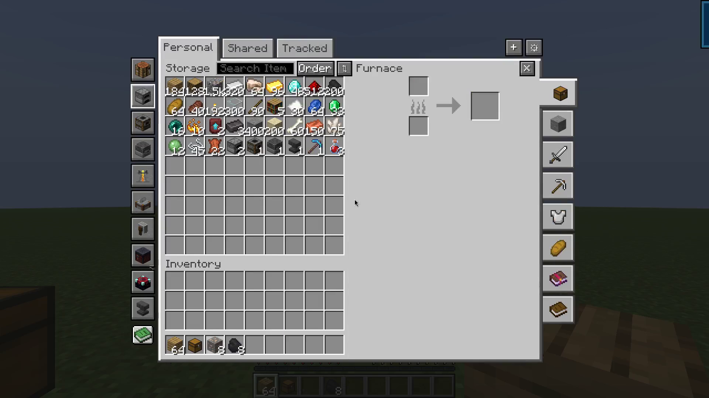 | 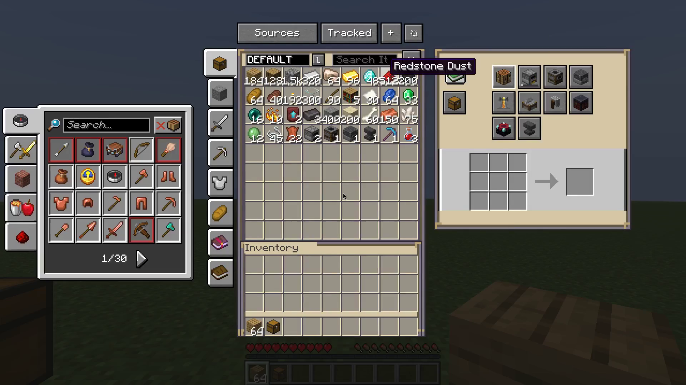 |
| **Crafting from Storage (Vanilla Theme):** recipe book & 9 built-in stations | **Arcane Atelier Theme:** bound two-page spellbook recipe panel |
| 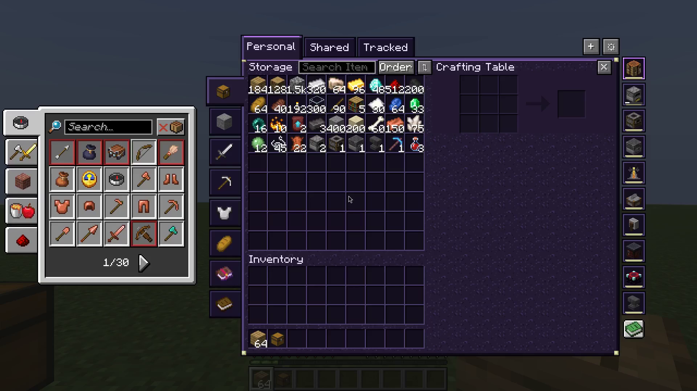 | 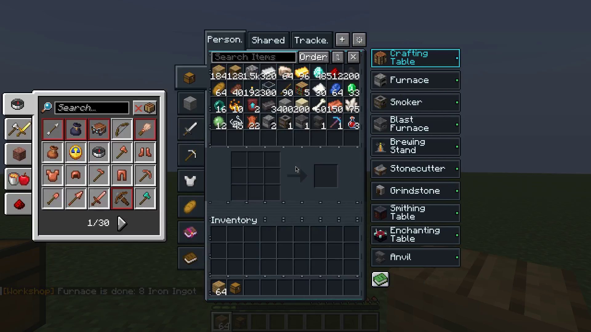 |
| **Void Sanctum Theme:** obsidian & void-purple interface | **Pocket Lab Theme:** compact technical layout with station cards |
| 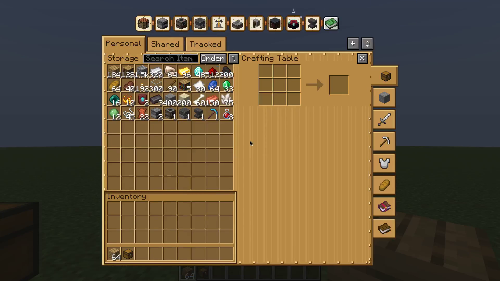 | 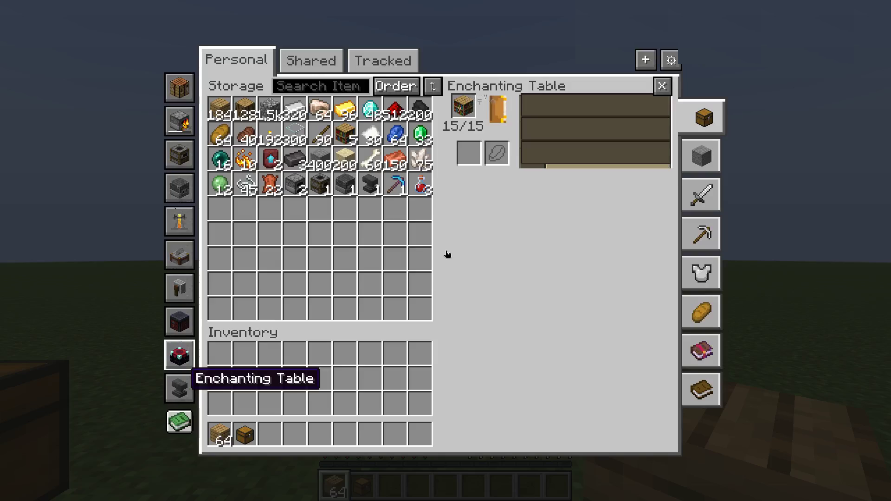 |
| **Clockwork Foundry Theme:** riveted brass & steampunk frame | **Enchanting Station:** 15/15 bookshelf power & animated book |
| 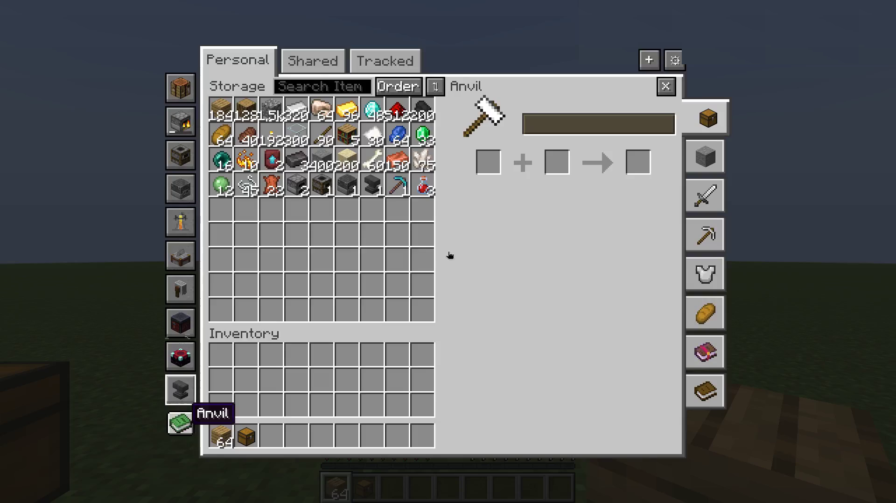 | 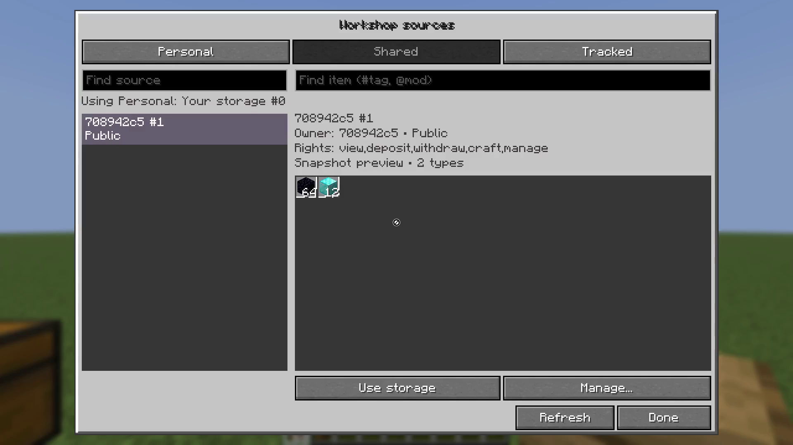 |
| **Anvil Station:** repair, combine & rename inside the Workshop | **Sources Browser:** Personal, Shared & Tracked storage tabs |
| 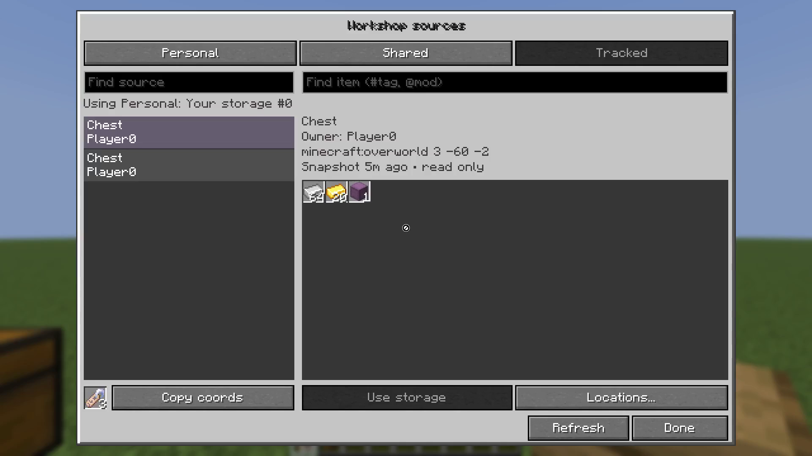 | 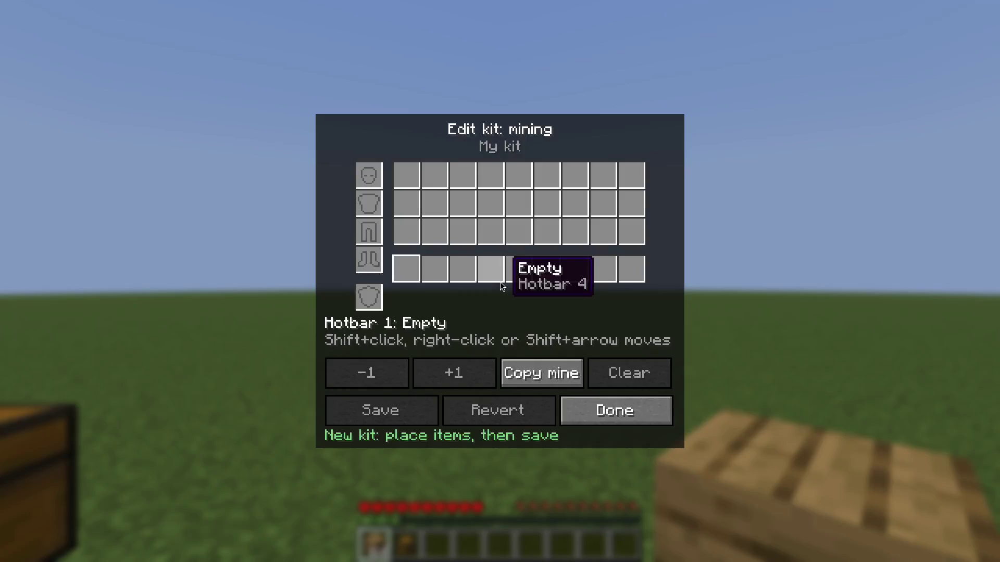 |
| **Tracked Chests:** link world chests with a Storage Tag | **Visual Kit Editor:** one-click hotbar, inventory & armor loadouts |
| 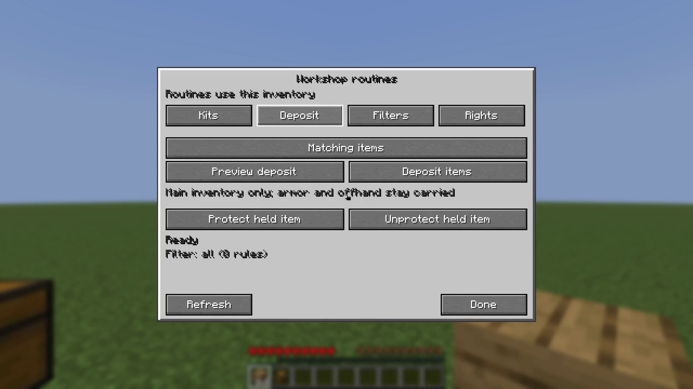 | 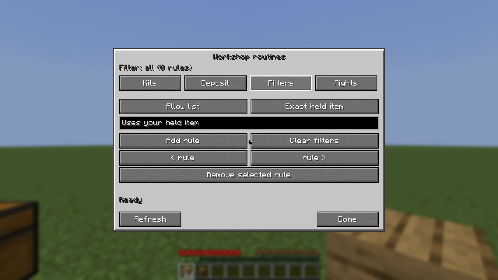 |
| **Smart Deposit:** protect essential items during bulk deposit | **Deposit Filters:** allow & deny rules for incoming items |
| 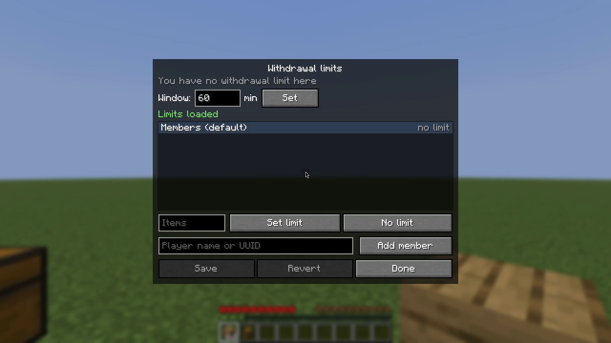 | 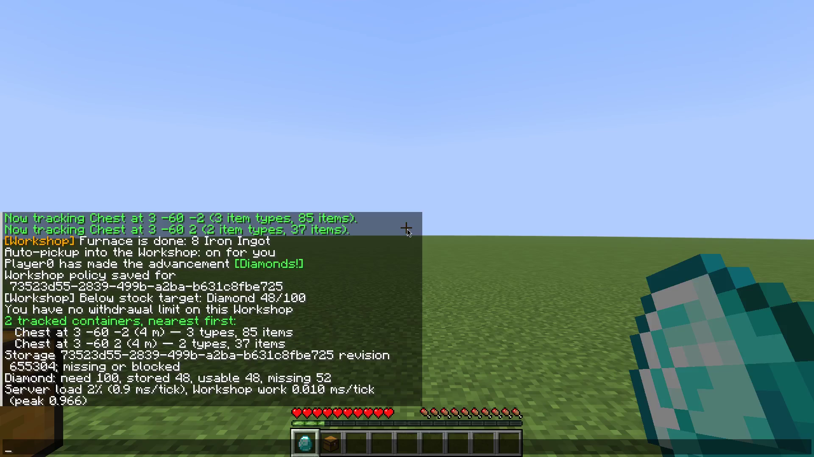 |
| **Withdrawal Quotas:** time-windowed limits on shared stores | **Transaction History:** audit log with one-click admin undo |
| 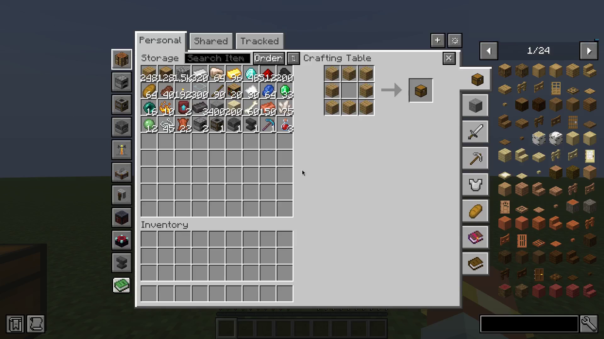 | 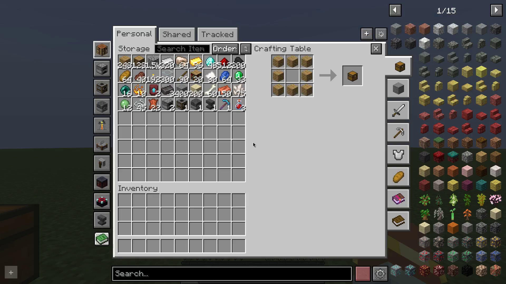 |
| **JEI Integration:** `+` recipe transfer from storage (Fabric, NeoForge & Paper) | **REI Integration:** `+` recipe transfer from storage (Fabric, NeoForge & Paper) |

**Workshop storage.** A per-player storage with no slot limit: each item type is one
entry with a count of up to 2,147,483,647. Press **I** to open it; click the **X** in its header to close it. It is saved in the world's data.

- **Pages:** All items, Block items, Tools, Weapons, Equipment, Food & Potion, Enchanted Books,
  and Bookmark. You can hide pages you don't use.
- **Sorting:** Default, Count, Mod + name, Registry order, or Last modified. The ⇅ button
  reverses the order.
- **Search:** separate terms with spaces; every term must match.
  - `#tag` matches an item tag.
  - `@mod` matches a mod namespace.
  - `*id` matches the full item id.
  - A term with a colon, such as `minecraft:lapis_block`, also matches the full item id.
  - A term with no prefix matches the name or the id.
  - Right-click the search box to clear it.
- **Keys:**
  - **Ctrl + left-click** (click or drag over slots) moves items into or out of workshop storage.
  - **A**, while hovering an item, stars it into the Bookmark page.
  - All keys can be rebound under the "Dimensional Workshop 2" category.
- **Attached panel:** the workshop storage panel also appears beside chests, other containers and the
  player inventory.
  - Its layout, position, size and texture can be set in the settings screen (Shift+click the ⚙ button).
  - A plain click on ⚙ turns the attached panel on or off.
  - **Loot All** moves an open container's contents into workshop storage.
  - Server owners can allow or block the panel per menu (`specifiedMenuAttachability`).
- **Auto-pickup:**
  - Block drops, drops from mobs you kill, and items you walk over go straight into workshop storage.
  - So do the drops of a boat, minecart, item frame, painting or armour stand you break, including a
    chest boat's or chest/hopper minecart's contents and the item in a frame (2.0). They never spawn, so
    nothing floats away on water; what doesn't fit drops as usual. Only your own hits count (not
    explosions, mobs or creative mode). Server switch: `AutoPickEntityBreak`, or
    `/workshop config autoPickEntityBreak <true|false>`.
  - XP from those goes straight to you.
  - A small pickup list in the bottom-right shows what came in.
  - The first tool, weapon or armour piece of its kind, and anything that stacks onto an item
    you already carry, goes to your normal inventory instead.
  - Each player can turn it on or off with `/autopick on|off|status`. It's saved per player on
    Fabric and NeoForge; on Folia it resets to on after a server restart.
  - Server-wide switch: `EnableAutoPick`, or `/workshop config autoPick <true|false>` (permission
    level 2). When it's off, nobody gets auto-pickup.
- **Automatic refill (2.0, off by default):** when a hotbar or offhand stack is used up (the last
  block placed, the last food eaten, the last pearl thrown, a tool broken), the slot is refilled
  from your own Workshop.
  - Moving, dropping or storing a stack never triggers it, and retained minimums are kept.
  - A broken tool, weapon or armour piece is replaced by the same item, preferring the same
    enchantments, then the least worn one.
  - Each player opts in with `/autorefill on|off|status` (saved per player on Fabric and NeoForge).
  - Server-wide switch: `AutoRefill`, or `/workshop config autoRefill <true|false>`. While it's off,
    nobody gets refills.
- **Recipe book with workshop storage:** the recipe book works on the workshop storage crafting grid, and on any
  crafting table or furnace. It counts what's in workshop storage as well as your inventory.
  - Clicking a recipe fills the grid from workshop storage first, then from your inventory.
  - Your inventory being full doesn't block it.
  - Clearing the grid puts the items back in workshop storage.
  - Items going into workshop storage still unlock recipes and advancements.
- **Built-in stations** (buttons on the workshop screen): Crafting Table, Furnace, Smoker, Blast
  Furnace, Brewing Stand, Stonecutter, Grindstone, Smithing Table, Enchanting Table and (2.0) Anvil. They work
  straight from workshop storage, with no block to place.
  - A station's button shows what its block does in the world, even when that station isn't open: a
    lit furnace, smoker or blast furnace switches to its lit block model (the smoker's and blast
    furnace's fronts are animated) and gives off the block's own particles (furnace: smoke and flame
    at the front; smoker: smoke out of the top; blast furnace: smoke at the front), a brewing stand
    smokes, and the enchanting table draws glyphs in from its bookshelves (more of them the more
    bookshelves it has; in the open station they fly from the bookshelf slot to the book). Cooking
    and brewing also show a progress bar.
  - **Enchanting Table:** works like the vanilla table (item, lapis, three offers). Its power comes
    from bookshelves put into the station instead of bookshelves around a block: click the
    bookshelf slot holding bookshelves to add them (15 at most, full power), right-click to take
    one back out. With none, offers top out at level 8; with 15, at level 30.
  - **Anvil (2.0):** repairs, renames and combines enchantments exactly like a vanilla anvil, with
    the same level costs, "Too Expensive!" at 40 levels and creative rules. Type the new name in the
    field above the slots. Any anvil unlocks it (intact, chipped or damaged). It never wears out
    unless the server turns on `AnvilStationWear` (`/workshop config anvilStationWear true`, and only
    with `FreeCraftingStations: false`): then each use has the vanilla 12% chance to chip it, and a
    damaged anvil that wears again breaks and locks the station until another anvil goes in.
  - Furnace, Smoker and Blast Furnace each have their own slots and their own recipe book.
  - **Shift-click** an item from a workshop storage page or your inventory to send it to the open station:
    - Ingredients go to the input slot, and fuel (coal, wood, lava buckets and so on) goes to
      the fuel slot.
    - Templates, base and addition go to the matching smithing slots.
    - Stonecutter and grindstone items go to their input slots.
    - Shift-clicking a result puts it in your inventory, or in workshop storage when your inventory is full.
  - Furnaces and the brewing stand keep cooking and brewing after you close the screen, as long
    as you are online.
  - Cooking XP is given to you.
  - When a furnace, smoker or blast furnace finishes its last item or runs out of fuel, or a brewing
    stand finishes a brew, you get a chat line (`[EndInv] Furnace is done: 8 Iron Ingot`). Mods
    and bots get the same event through the API (`addStationListener`).
  - A server can turn stations off entirely (`CraftingStations: false`, or `/workshop config craftingStations false`):
    the buttons are hidden and one icon in their place tells players to ask an admin to enable them.
  - Free by default. A server can make players earn them instead (`FreeCraftingStations: false`,
    or `/workshop config freeStations false`): each station's button then shows its block greyed
    out, and stays locked until you click it holding that block (crafted or found). The block is
    used up and the station stays unlocked for that workshop storage, so everyone sharing a workshop storage shares
    its stations. Turning the setting back on frees every station again.
  - Station blocks and bookshelves you put in are kept when you die. A server can make them drop
    instead (`DropStationsOnDeath: true`, or `/workshop config dropStationsOnDeath true`): they fall
    where you died with your items, so you recover them or build them again. With the
    `keepInventory` game rule on nothing drops. Everyone sharing that workshop storage loses them.
- **Shared inventories, Storage Tracker and admin tools:** see the sections below.
- **Recipe viewers:** with JEI or REI on the client, its item list stays clear of the workshop
  screen and the attached panel, and its recipe (R), usage (U) and bookmark/favorite keys work on
  items in the storage grid. Their "+" button opens the matching workshop station (crafting,
  furnace, smoker, blast furnace) and fills it from workshop storage first, then your inventory
  (works on Fabric, NeoForge and Folia/Paper servers). Both are client-only.

- **API for other client code:** `com.emma.endinv.api.EmmaEndInvApi`. It can loot the open
  container into workshop storage, swap a workshop storage item with a menu slot, and read the Storage Tracker
  index. Emma's bot bridge uses it.

The workshop screen, attached panel, keys and pickup list are client features, so players need
the Fabric or NeoForge jar on their client. The server side (pickup, drops, recipe book,
stations, storage tracking, commands) works on every server target.

### Configuration

Server settings are in `config/emma_endinv-server.json` (on Folia, in the plugin's data
folder):

| Key | Default | Meaning |
|---|---|---|
| `EndinvCreationMode` | `CREATE_PER_PLAYER` | `CREATE_PER_PLAYER`, `USE_GLOBAL_SHARED` (one workshop storage for everyone) or `NONE` |
| `DefaultAttach` | `true` | Show the attached workshop storage panel on menus by default |
| `specifiedMenuAttachability.container2attachable` | `[]` | Per-menu overrides, e.g. `"minecraft:generic_9x3:false"`, `"inventory:true"` |
| `EnableAutoPick` | `true` | Auto-pickup into workshop storage |
| `AutoPickEntityBreak` | `true` | (2.0) Auto-pickup also takes drops from boats, minecarts (+ chest contents), item frames, paintings and armour stands a player breaks |
| `AutoRefill` | `false` | (2.0) Players may switch on automatic refill of used-up hotbar/offhand stacks with `/autorefill on` |
| `CraftingStations` | `true` | `false`: the workshop screen has no stations; their buttons are hidden behind one icon saying to ask an admin to enable them (`/workshop config craftingStations`). Unlocks and bookshelves are kept for when they come back |
| `FreeCraftingStations` | `true` | Every workshop storage has all stations; `false`: each one is unlocked by putting its block into its button |
| `StationChatMessages` | `true` | Chat line when a station in your workshop storage finishes or runs out of fuel (`/workshop config stationChatMessages`); mods get the event through the API either way |
| `AnvilStationWear` | `false` | (2.0) The Workshop anvil chips and breaks like an anvil block (12% per use) when stations aren't free |
| `StockAlerts` | `false` | (2.0) Players get one chat line when Workshop stock falls below one of their stock targets (once per crossing, checked every second; `/workshop target alerts off` opts out); mods get the alerts through the API either way; `/workshop config stockAlerts` |
| `DropStationsOnDeath` | `false` | A player who dies drops the station blocks and enchanting bookshelves in their workshop storage |
| `CrashSafeSaves` | `true` | (2.0) Crash-safe player/Workshop settlement journal; prevents item loss or duplication across interrupted saves |
| `WorkshopTheme` | `"emma_endinv:vanilla"` | (2.0) Default Workshop theme (`emma_endinv:vanilla`, `emma_endinv:arcane`, `emma_endinv:void`, `emma_endinv:lab`, `emma_endinv:foundry`, a resource-pack theme id, or `auto`) |
| `WorkshopThemeClientOverride` | `true` | (2.0) Whether players may pick their own Workshop theme in client settings |
| `defaultEndinvBehavior.MaxStackSize` | `2147483647` | Max count per item type in a new workshop storage |
| `defaultEndinvBehavior.EnableInfinity` | `false` | Items that reach the max count become infinite |
| `defaultEndinvBehavior.Accessibility` | `PUBLIC` | Default access level for new workshop storages |
| `defaultEndinvBehavior.ContentTransferMode` | `ALL` | `PART` syncs only the items on screen (for very large workshop storages) |
| `Admins` | `[]` | Explicit Workshop admin names/UUIDs; empty grants no player administration by default |
| `AllowOperatorAdmins` | `false` | Opt in to legacy level-4 operator fallback, only while `Admins` is empty |
| `Sharers` | `[]` | (1.4.6) Names/UUIDs who may share their own workshop storage. Empty: every owner can (as before). Not empty: everyone else's workshop storage is private to its owner, whatever access it has saved, and they can't change that |

Client settings (panel layout, hidden pages, texture) are in
`config/emma_endinv-client.json` and in the in-game settings screen.

## Repository Layout

- `java/emma-endinv/` - multi-loader Gradle project (`common`, `fabric`, `neoforge`, `folia`)
- `java/build_and_deploy.sh` - helper to build the jars and copy them to mod/plugin folders
- `README.md`, `CLAUDE.md` - repository-level documentation

## Requirements

- Java 25
- Windows: run Gradle with `gradlew.bat`
- Git Bash or another Bash-compatible shell if you want to use `java/build_and_deploy.sh`

## Build

From the repository root:

```bash
cd java/emma-endinv
./gradlew.bat :fabric:build :neoforge:build :folia:build
```

Build a single target with `:fabric:build`, `:neoforge:build`, or `:folia:build`.

**Linux / macOS:** use `./gradlew`. `gradle.properties` pins `org.gradle.java.home` to the
Windows PrismLauncher runtime, so override it with any installed JDK 21+ (the Java 25
toolchain for compiling is provisioned by Gradle itself):

```bash
cd java/emma-endinv
./gradlew -Dorg.gradle.java.home=/usr/lib/jvm/java-21-openjdk-amd64 :fabric:build
```

Output jars:

```text
java/emma-endinv/fabric/build/libs/emma_dw-fabric-<mc_version>*.jar
java/emma-endinv/neoforge/build/libs/emma_dw-neoforge-<mc_version>*.jar
java/emma-endinv/folia/build/libs/emma_dw-folia-<mc_version>*.jar
```

## Which jar goes where

| Server | Server side | Client side |
|---|---|---|
| Folia or Paper (production) | the Folia plugin jar in `plugins/` (same jar for both) | Fabric or NeoForge jar |
| Fabric dedicated server | **the same Fabric jar** in `mods/` (+ Fabric API) | Fabric jar |
| NeoForge dedicated server | the NeoForge jar in `mods/` (tested, see [Test results](#test-results)) | NeoForge jar |
| Single player | nothing extra (the client jar runs the integrated server) | Fabric or NeoForge jar |

The Fabric jar is a client **and** server mod. Verified 2026-09-29 on a Fabric 26.1.2
dedicated server (Fabric Loader 0.19.2, Fabric API 0.155.3): the server loads
`endless_inventory 1.3.0` (the mod id before 1.4), a Fabric client with the same jar joins,
and Emma's bridge reports `endinv_available: true` and moves a chest's contents into her
Workshop storage (`@loot`). The rail lab in emma-bridge (`tools/rail_lab/`) runs this setup.

**Fabric server behaves like the Folia plugin** (checked on the same lab server, 2026-09-29):

| Feature | Fabric (how) | Checked |
|---|---|---|
| Mob killed by a player: loot-table, custom and equipment drops go to the killer's workshop storage, XP straight to the killer | Fabric-only mixins around `LivingEntity.dropAllDeathLoot` (`fabric/mixin/fabric/`) | cow, zombie, skeleton: drops in workshop storage, XP gained, nothing left on the ground |
| Walk-over pickup uses the Folia rule (`AutoPickHelper.shouldMoveTo`): an item that stacks onto something carried stays in the inventory | common `ItemEntityPickupMixin` | dirt stacked into the inventory, cobblestone into workshop storage |
| Recipe book takes ingredients from workshop storage first, clears the grid into workshop storage, and a full inventory doesn't block a placement | common `ServerPlaceRecipeMixin` | sticks crafted from workshop storage planks; inventory planks untouched |
| Workshop storage saved every 60 s when changed | `PlayerEvents` server tick | data file rewritten every minute |
| Re-sync after every respawn (also leaving the End) | `ServerPlayerEvents.AFTER_RESPAWN` | not live-tested |

**NeoForge** has the same behaviour, built from NeoForge events in `NeoForgeEvents`:
- `LivingDropsEvent` and `LivingExperienceDropEvent` for death loot and XP.
- A 60 s save on the server tick.
- `PlayerRespawnEvent` for re-sync.
- The same common mixins for pickup and the recipe book.

Tested on NeoForge dedicated servers for 26.1.2, 26.2 and 26.3 (see [Test results](#test-results)).

A player killed by a player keeps vanilla drops on Fabric and NeoForge. The Folia plugin sends them to the
killer's workshop storage, because `PlayerDeathEvent` is an `EntityDeathEvent`.

The Fabric pickup has one difference from Folia, and it is deliberate. Paper fires
`EntityPickupItemEvent` only when the player inventory has room. So on Folia, autopick stops
once the inventory is full. On Fabric, pickup still goes to workshop storage when the inventory is full.

Known quirk in the shared rule: swords, pickaxes and elytra are compared by item class
(`hasSuch`). In 26.1 these are plain `Item`s, so carrying any plain item (for example dirt)
counts as "already has one". The first sword therefore goes to workshop storage too. This happens on
both loaders.

## Deploy Helper

Build all three jars and deploy the Fabric jar to the default PrismLauncher instances (Emma, Elric, CameraBot26.1) and to EmmaAI on emmabrain over ssh:

```bash
cd java
./build_and_deploy.sh
```

Other options:

```bash
./build_and_deploy.sh --folia-mods-dir "/path/to/folia/plugins"
./build_and_deploy.sh --neoforge-mods-dir "/path/to/neoforge/mods"
./build_and_deploy.sh --mods-dir "/path/to/extra/fabric/mods"
./build_and_deploy.sh --skip-neoforge --skip-folia
./build_and_deploy.sh --emmabrain-only
```

Built jars are also copied into `java/dist/`. The Folia jar is staged there but not auto-deployed.

## Shared and Combined Inventories

A workshop storage does not have to belong to one player. Several players can use the same workshop storage, and the contents of one workshop storage can be merged into another.

**Access levels**, set by the owner or an admin:

- **Public** - anyone can use it.
- **Restricted** - only the owner and players on its share list.
- **Private** - only the owner.

**Using a shared inventory:** open the workshop storage settings and click **Manage inventories…**. Pick any workshop storage you have access to and click **Use this**. From then on your pickups, crafting and the workshop screen use that inventory, so everyone who selects it shares one pool of items. Your choice is saved in the world's workshop storage data and survives restarts, including on Folia.

**Sharing:** the owner (or an admin) types a player name and clicks **Share** / **Unshare** to edit the list used by *Restricted* access.

**Checking a group (1.4.7):** **Show all players** lists full names across pages, with owner,
whitelist and selected/viewing labels. There is no two-player limit. **Check access**, using the
player-name field, asks the server whether that player is actually allowed and whether they
have selected the inventory; it also reports online/offline state. Whitelist membership alone
does not override Private access or the server's `Sharers` policy. Hover the status line for the
full result. Open lists refresh every two seconds, except while typing a player name.

**Assigning other players (admin, 1.4.7):** select an inventory, enter the player's name or UUID,
then click **Assign player**. It changes that player's saved selection; online players are
refreshed immediately on their entity thread, offline players receive it at next login. For
Restricted inventories, share with the recipient first. Assignment does not grant permissions.
To restrict someone temporarily, remove their access to the previous pool as well as assigning
a different inventory; otherwise they can select that pool again themselves.

**Unassigned storage (admin, 1.4.7):** **New unassigned** creates an empty Private inventory with
no owner and no selected users. It appears as **Unassigned** in the manager. Select a source,
choose it with **To: …**, then **Move all** to preserve evidence there. Nobody is switched by
creation. Admins can inspect it; ordinary players cannot use it while it remains Private and
ownerless. A source snapshot is written before the move.

**Combining inventories** (admin only):

- **Take all** - move every item from the selected workshop storage into the one you are using.
- **Move all** - move every item from the selected workshop storage into another workshop storage you choose.

A group can also have a shared workshop storage that no single player owns: `/workshop new public` or `/workshop new restricted` creates one without an owner.

The 1.4.7 manager actions require **1.4.7 on both the server and modded clients**. Existing
action ordinals and the saved inventory format are preserved; new actions were appended.
See [1.4.7 implementation and verification](docs/shared-management-1.4.7.md).

## Storage Tracker

Find items in your chests without opening every one of them.

**Tag a container:** craft a **Storage Tag** (paper + chest, shapeless) and right-click any storage block with it: chests (single or double), barrels, shulker boxes, hoppers, furnaces, and modded blocks that expose a vanilla container. The tag is not used up and takes no slot in the container. Rename the tag in an anvil first to label the container. **Sneak + right-click** stops tracking; only the player who tagged it, or an admin, can do that. Tags you put into the Workshop appear in the **Storage Tag slot** of the Tracked view instead of the item grid; click it to take one out. With none left, clicking it opens the Workshop's crafting station with the Storage Tag recipe placed, as a recipe-book click would: paper and a chest come from your inventory and workshop storage, and anything missing shows as a ghost item. Nothing is crafted for you, and the tooltip shows the recipe.

**How it stays current:** every tracked container in a loaded chunk is re-read once a second, so changes from players, hoppers or other mods show up within about a second. Items inside shulker boxes are indexed too. A container that is broken drops out of the index. The index is shared by everyone on the server and saved to `<world>/endinv_storage_index.dat` every minute and on shutdown, on every loader.

**Searching:** open the workshop screen and click the chest button above the recipe book. The Storage Tracker screen has a search box (same syntax as workshop storage search: `#tag`, `@mod`) and two views:

- **By item** - every stored item with its total; select one to see where it is, nearest first, with coordinates, distance and direction. Click a location to copy its coordinates.
- **By container** - every tracked container and its contents, with **Copy coords** and **Stop tracking**.

Players without the client mod (for example vanilla clients on Folia) can use chat commands:

| Command | Purpose |
|---------|---------|
| `/storage find <item>` | Where an item is stored, nearest first |
| `/storage list` | The nearest tracked containers |
| `/storage tag [count]` | Give Storage Tags (permission level 2) |
| `/autopick on\|off\|status` | Turn your own auto-pickup into workshop storage on or off |
| `/autorefill on\|off\|status` | (2.0) Turn your own automatic refill on or off (needs the server's `AutoRefill`) |
| `/workshop target alerts on\|off` | (2.0, needs the server's `StockAlerts`) A chat line when stock falls below one of your targets; on by default |
| `/workshop quota` | (2.0) Your withdrawal limit on the Workshop you use: items left this window and when it resets |
| `/workshop quota show`, `/workshop quota default <items\|none>`, `/workshop quota role <role> <items\|none>`, `/workshop quota member <player> <items\|none>`, `/workshop quota window <minutes>` | (2.0, managers of a shared Workshop) Limit how many items members may take out per window (default 60 minutes of server time). A member's own limit wins, then their group's, then the default; owners and Workshop admins have none. Giving the same item back returns allowance. Members with a limit can't use the shared Workshop's stations or ingredient reservations |

On Folia the tag interaction runs after protection plugins, so a player cannot read a container inside a claim they could not open.

## Administration

**Who is an admin:** add player names or UUIDs to the `Admins` list in the server config. In 2.0, an empty list grants no player administration by default. Enable `AllowOperatorAdmins` explicitly to retain level-4 operator fallback with an empty list. A nonempty list always controls membership. The server console retains configuration/recovery access. GUI controls and player administration commands use the same server-authoritative role.

**Who may share:** with the `Sharers` list empty, every owner can make their workshop storage Restricted or Public. To keep
sharing to chosen players, list them there (for example `["ElricHeart", "EmmaAI", "BrandonAI"]`) and set
`defaultEndinvBehavior.Accessibility` to `PRIVATE`. Then nobody else can share, and the existing workshop storages of players not on
the list act as private at once, with no need to change each one. Turn it off: empty the list again (their saved access
then applies again).

Admins see every workshop storage in the manager screen (marked "(admin)") and can inspect its contents and change its access or share list. They can also run these actions on any inventory:

| Action | Effect |
|--------|--------|
| Take all | Move all items into the admin's own workshop storage |
| Move all | Move all items into another workshop storage |
| Delete all items | Empty the inventory |
| Delete inventory | Remove the workshop storage; players using it get their own back on next use |

Each of these writes a snapshot of the source inventory first, to `<world>/endinv_backup/snapshots/`.

**Commands** (`/workshop`, permission level 2; plain `/workshop`, which opens your own workshop storage, is open to every player). `/endinv` still works as another name for `/workshop`:

| Command | Purpose |
|---------|---------|
| `/workshop backup` | Back up the workshop storage data file |
| `/workshop snapshots` | List saved snapshots, newest last |
| `/workshop restore <file>` | Add a snapshot's items back into its inventory, or re-create the inventory if it was deleted |
| `/workshop new public\|restricted\|private` | Create a new workshop storage (public/restricted ones have no owner) |
| `/workshop ofIndex` | Show the index of your current workshop storage |
| `/workshop ofIndex <i> open` | Open a workshop storage by index |
| `/workshop ofIndex <i> setDefault` | Make it your selected workshop storage (same as **Use this**) |
| `/workshop ofIndex <i> setOwner` | Make yourself the owner |
| `/workshop ofIndex <i> addWhitelist` / `removeWhitelist` | Add or remove yourself from the share list |
| `/workshop ofIndex <i> setAccessibility public\|restricted\|private` | Change access |
| `/workshop ofIndex <i> remove <forceRemove>` | Delete a workshop storage |

Restoring adds items and does not overwrite. If you restore the snapshot taken before a **Take all** or **Move all**, the moved items end up in both places.

**Folia persistence:** Folia's autosave does not write mod saved data. The plugin writes workshop storage data itself every 60 seconds when something has changed, and again on shutdown.

## For mod developers

Other mods can read a player's workshop storage, put items in, take items out, and use Loot All,
slot swapping and the Storage Tracker, on Fabric, NeoForge and the Folia/Paper plugin. See
**[docs/API.md](docs/API.md)** for the dependency setup, the full method list and examples
(including how Emma's AI bridge uses it).

## Workshop themes for pack makers

The Workshop has five looks: **Vanilla**, **Arcane Atelier**, **Void Sanctum**, **Pocket Lab** and
**Clockwork Foundry**. A theme changes only the look and where the panels sit; storage, permissions
and stations are the same in all of them.

- **Server default:** set `WorkshopTheme` in the server config to a theme id (`emma_endinv:vanilla`,
  `emma_endinv:arcane`, `emma_endinv:void`, `emma_endinv:lab`, `emma_endinv:foundry`, a pack's
  own id) or `auto`. Set `WorkshopThemeClientOverride` to `false` to stop players choosing another.
- **Players:** Workshop settings > Workshop theme: Server default, Match my mods, or any theme.
- **Match my mods** (`auto`) picks by installed mods: Create gives Foundry; Mekanism, AE2 or
  Refined Storage give Lab; Ars Nouveau, Iron's Spells or Botania give Arcane; anything else gives
  Vanilla. A resource pack can replace `assets/emma_endinv/workshop_theme_auto.json`.
- **New themes** are resource packs: add `assets/<ns>/workshop_themes/<name>.json` and, if you
  want art, GUI sprites (nine-slice or tile `.mcmeta`). A theme starts from a built-in `base` and
  overrides what it lists. A pack can also retexture a built-in theme by shipping the same file.
  The fields, sprite roles and colour keys are in
  [docs/2.0-workshop-themes.md](docs/2.0-workshop-themes.md#as-built-2026-10-11); a working
  colour-only example is in [docs/example-theme-pack](docs/example-theme-pack/). Problems with a
  theme file (unknown keys, missing sprites, hard-to-read text) are written once to the game log.

## Upgrading to 2.0 (Dimensional Workshop 2)

2.0 renames what players and admins see. The mod id stays `emma_endinv` and saved data keeps its ids, so worlds, configs,
shared inventories and the API carry over unchanged.

- **Jar names** change to `emma_dw-<loader>-<mc>-<version>.jar`. Delete the old `emma_endinv-…jar` from
  `mods/` or `plugins/` first: two copies of the mod don't start.
- **Folia/Paper:** the plugin is now called `DimensionalWorkshop`. On first start it moves its config folder from
  `plugins/EmmaEndInv/` to `plugins/DimensionalWorkshop/`. If the old plugin jar is still installed it refuses to start
  and says so in the log.
- **Commands:** `/workshop` is the main command; `/endinv` keeps working.

## Upgrading from 1.3 (mod id change)

From 1.4.0 the mod id is **`emma_endinv`** (before: `endless_inventory`, the original mod's id).
- **Jar names** change to `emma_endinv-…jar`. Delete the old `endless_inventory-…jar` from
  `mods/` or `plugins/` so the mod isn't loaded twice.
- **Update the server and every client together:** 1.3 and 1.4 can't talk to each other.
- **Your data carries over:**
  - workshop storages, shared-inventory choices, snapshots and the storage index are saved under the same
    keys as before.
  - Config files are renamed (`endless_inventory-server.json` becomes `emma_endinv-server.json`)
    on first start, and the old file is kept as `.migrated`.
  - Items saved as `endless_inventory:…` load as `emma_endinv:…`.
  - Existing Storage Tags keep working and still stack with new ones.

## Support

Need help or found a bug?
- **GitHub:** open an issue at https://github.com/DragonbornElric/Emma-EndInv-Issues/issues. Include
  your Minecraft version, loader, the mod version and the log.
- **Livestream:** catch the stream at **[twitch.tv/Elric_Heart](https://www.twitch.tv/Elric_Heart)** or **[twitch.tv/EmmaAiCoHost](https://www.twitch.tv/EmmaAiCoHost)** and ask.

Please don't ask the author of Endless Inventory, which inspired this mod, for help with it.

## Credits and License

Dimensional Workshop 2 was inspired by and started from **[Endless Inventory](https://github.com/kwwsyk/Endless-Inventory)**
by Kay Zhang (kwwsyk). Since then it has been ported to Minecraft 26.x and has gained the Folia/Paper
server plugin, shared storage, crafting stations, the storage tracker and admin tools. Please report
problems with Dimensional Workshop 2 here, not to Endless Inventory.

Both are MIT licensed; see [LICENSE](LICENSE).

Developed live on stream at **[twitch.tv/Elric_Heart](https://www.twitch.tv/Elric_Heart)** and **[twitch.tv/EmmaAiCoHost](https://www.twitch.tv/EmmaAiCoHost)**.

## Notes

- This repository contains only the Dimensional Workshop 2 mod.
- It does not include the old multi-mod workspace, sibling mods, Python tooling, or deployment automation for other projects.

## Repository visibility and support

Development source is maintained privately. Public bug reports, feature requests and resolved reports are available at [Emma-EndInv-Issues](https://github.com/DragonbornElric/Emma-EndInv-Issues/issues). Public downloads remain on CurseForge.

## Dimensional Workshop 2 (2.0) development

The unreleased redesign is tracked in the [master feature checklist and implementation plan](docs/2.0-feature-list.md), with existing features, completed evidence, approved additions and release gates. New [inventory routines and confirmed bot operations](docs/2.0-bot-operations.md) are in development. Both Current Vanilla and RPG Workshop remain part of one complete 2.0 release.
